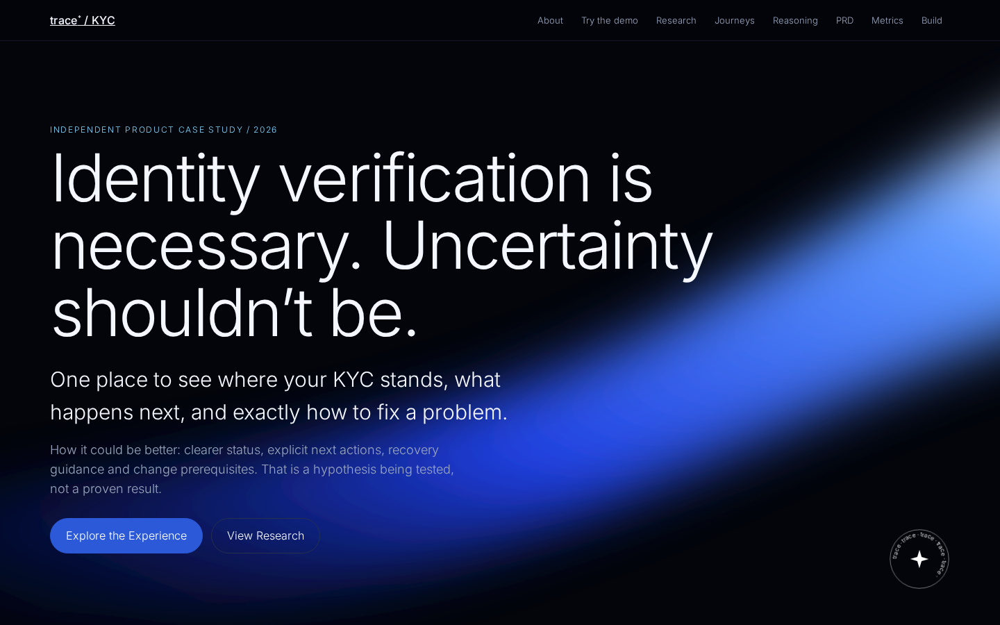
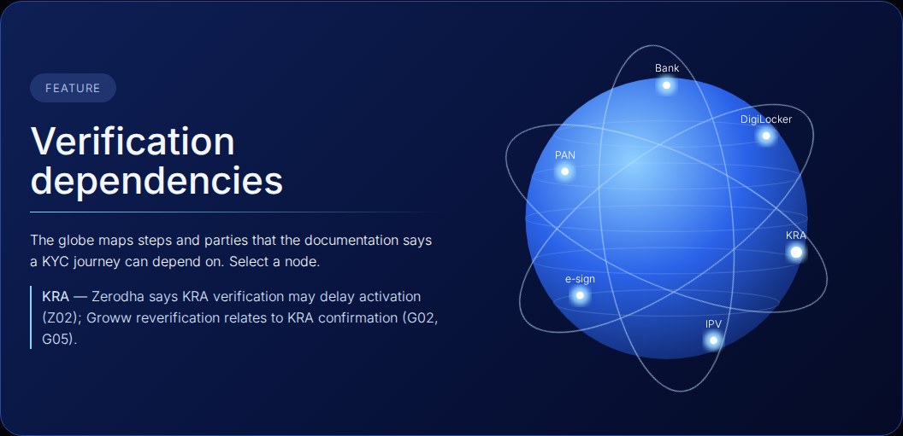
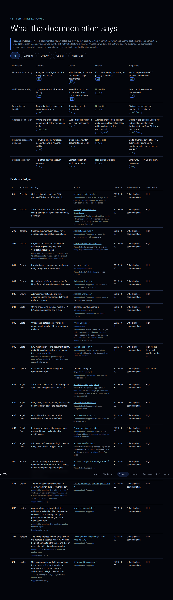
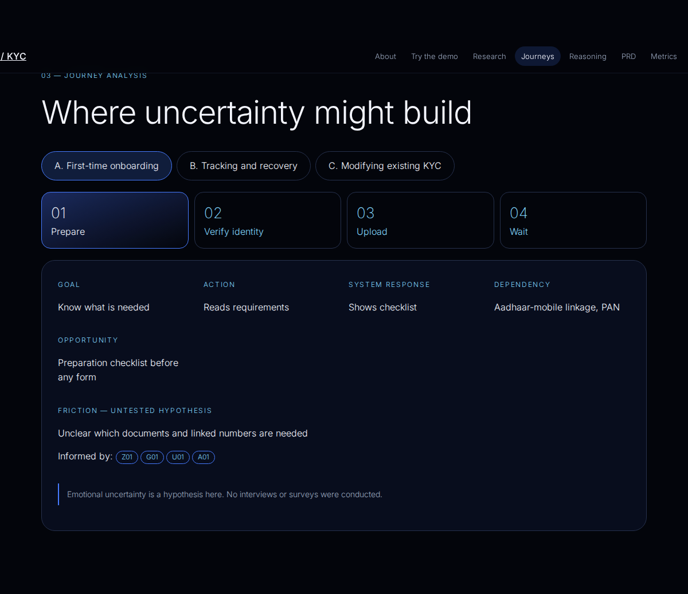
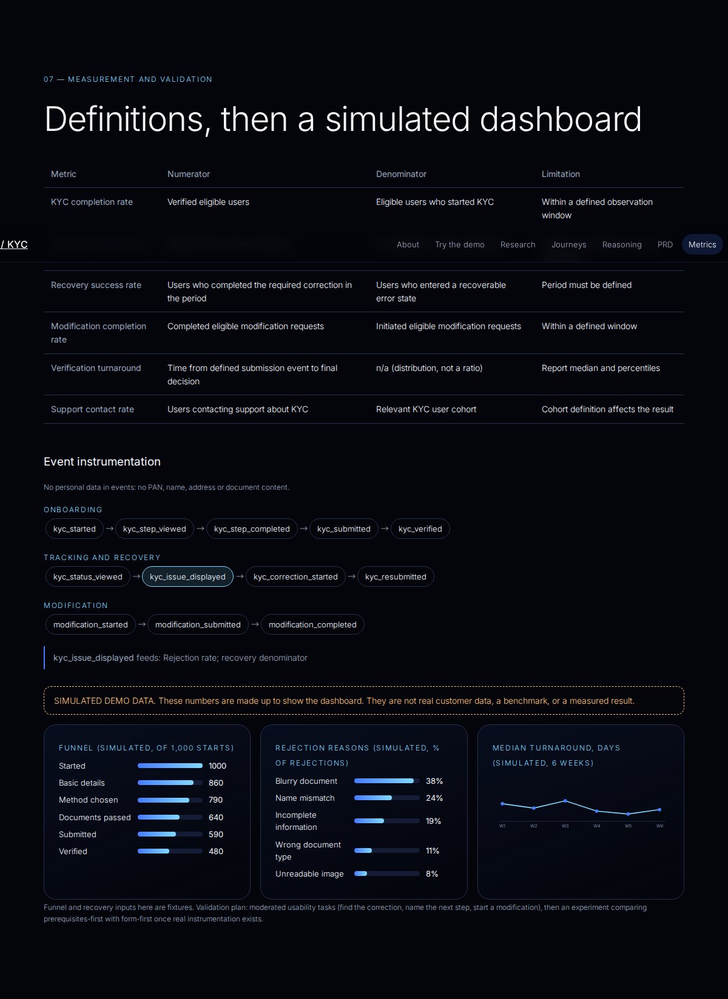
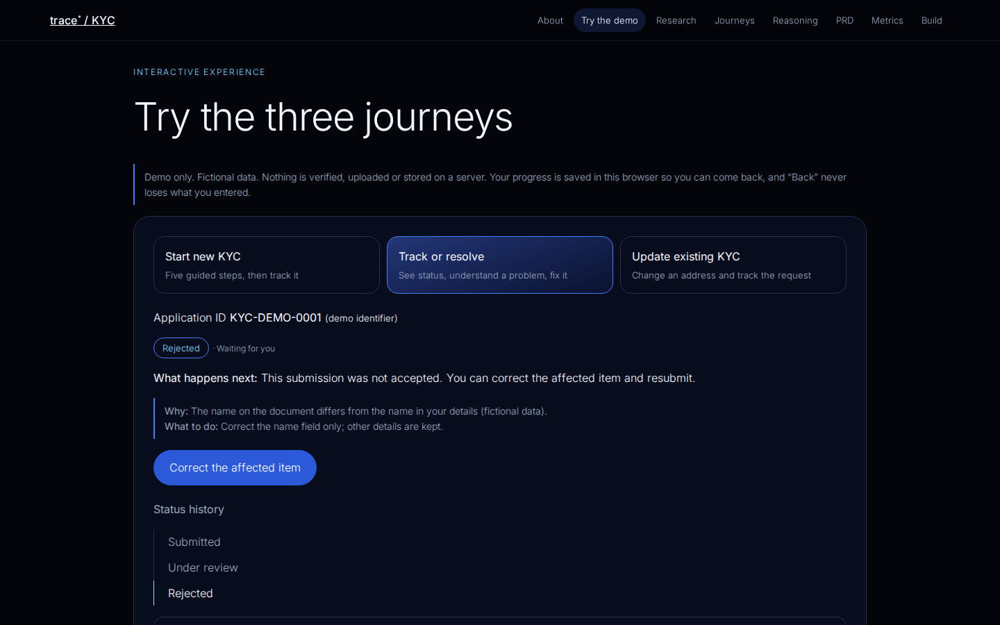
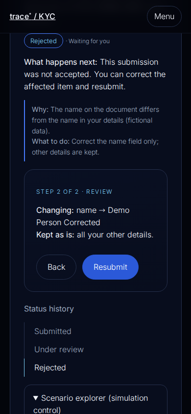
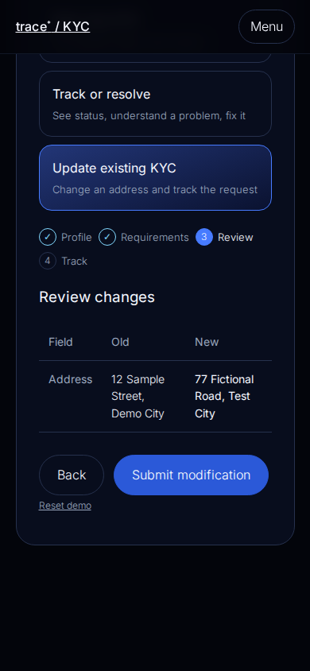

# TRACE / KYC

**Identity verification is necessary. Uncertainty shouldn't be.**

An independent product management case study and a clickable prototype about how people start, track, fix and update their KYC with an Indian broker. It is not an official product of any broker or KYC provider, it never touches real verification systems, and everything in the demo is fictional.

Live demo: not deployed yet. See `DEPLOYMENT_CHECKLIST.md`. Release status and evidence: `RELEASE_AUDIT.md`.

---

## 1. Why I'm making this

KYC is the first thing a new investor hits and the thing an existing one gets pulled back to when details change or a record goes on hold. It is also a process where several different parties are involved at once: the user, the broker, a KYC registry, and government services like DigiLocker. When something stalls, it is not obvious to the user which of those is holding things up.

That makes it a good product problem. The rules are fixed and can't be designed away, but the explanation layer on top of them (what is pending, who has it, what do I do next) is a design choice. I wanted a project where I had to separate what the regulation requires from what the interface decides, and then be honest about which of my ideas are evidence-based and which are guesses.

It is also a project I can defend in an interview because the claims are small and sourced.

## 2. KYC basics (what this project assumes you know)

*Know Your Customer* is the identity check a financial firm has to complete before it lets you invest or trade. In India the securities side is overseen by SEBI, and the checks sit within anti-money-laundering rules. I'm describing the general picture here, not giving legal advice. Check the regulator's own pages for anything binding.

The pieces that come up again and again in the sources I read:

| Term | What it is, in plain terms |
|---|---|
| **PAN** | Permanent Account Number from the Income Tax Department. Brokers check that the name on it matches your other documents. |
| **Aadhaar** | Government identity number. Online onboarding commonly relies on it being linked to your mobile number. |
| **DigiLocker** | Government document service. Platforms can fetch documents from it with your consent instead of asking for uploads. |
| **OVD** | Officially valid document, a government-issued proof of identity or address. |
| **IPV** | In-person verification. Online, this is usually a short live selfie or video so the person matches the documents. |
| **e-sign** | Signing the application digitally, commonly with Aadhaar-based OTP. |
| **KRA** | KYC Registration Agency. A registry that stores your KYC record so other intermediaries can reuse it. A record can show states such as validated, registered, on hold or rejected, and a broker can be waiting on it. |
| **Re-KYC / reverification** | Being asked to confirm or refresh details, for example after a name, address or contact change. |

Two things follow from this and shape the whole design. First, **KYC is a chain of dependencies**, and some links are outside the broker. Second, **a rejection is usually fixable**, because the cause is typically one document or one mismatched field, so the experience after a rejection matters as much as the experience before it.

## 3. The problem I'm investigating

> Users may meet avoidable uncertainty during KYC because requirements are unclear, steps are spread across parties, status is hard to read, errors are hard to recover from, and changes to an existing record are confusing.

This is a **hypothesis**, not a finding. I have not interviewed users, run a survey or tested a live app. What I did is read what four platforms publicly document and ask where an explanation layer might help.

## 4. How it could be better (and what I'm not claiming)

I'm not claiming TRACE is better than Zerodha, Groww, Upstox or Angel One. Several of them already document status tracking, specific rejection reasons and resubmission. The research showed that detailed rejection explanations already exist in the market, so inventing them is not my angle.

The question I'm testing is narrower: **does putting the explanation, the next action and the prerequisites in one consistent place make KYC easier to get through?** The five proposals, all untested:

| ID | Proposal | Builds on evidence | Metric to watch |
|---|---|---|---|
| P1 | Show the specific reason and the corrective action on the same screen | Z03, A02, A03 | Recovery success rate |
| P2 | Split "waiting for you" from "under external review" | Z02, G02, G05 | Status-related support contact rate |
| P3 | Show prerequisites before a modification starts | G03, A05, Z04 | Modification initiation-to-completion |
| P4 | Let eligible changes share one request | A04, U05 | Repeated-step rate |
| P5 | Give timing guidance with stated uncertainty | Z02, G01, A01, G05 | Perceived clarity in usability tests |

Each has alternatives, trade-offs and a validation plan in [`docs/design-decisions.md`](docs/design-decisions.md). No improvement in real outcomes is claimed anywhere in this repo.

## 5. Scope: three journeys

- **A. First-time KYC**: prepare, enter demo details, choose a simulated verification method, run a simulated document check (clear, blurry or wrong document), review, submit.
- **B. Track and resolve**: an eight-state status tracker (not started, draft, submitted, under review, additional information required, rejected, resubmitted, verified), specific reasons with a next action, correct-and-resubmit, and a scenario explorer that disables moves the state machine does not allow.
- **C. Update existing KYC**: see which fields are editable, enter a new address, compare old and new values side by side, submit a separate modification request, track it on its own.

Out of scope: real verification, real documents or identifiers, regulatory interpretation, any provider integration.

## 6. Research method

- **Platforms:** Zerodha, Groww, Upstox, Angel One.
- **Sources:** official public documentation and support pages only.
- **Date:** all entries accessed 2026-10-30.
- **Evidence type:** every entry is labelled *Official public documentation*. Nothing here is direct usability testing.
- **Per entry I record:** platform, finding, source, access date, evidence type, confidence, and (in the decision docs) the product implication.
- **Rule:** if I couldn't verify something it says *Not verified*. A missing mention in documentation is not treated as a missing feature.
- **No scores:** I haven't defined or applied an evaluation method, so there are no numerical usability ratings.

Evidence ledger: [`docs/competitor-benchmarking.md`](docs/competitor-benchmarking.md). Source registry: [`docs/research-sources.md`](docs/research-sources.md).

### What the research showed
All four platforms document KYC-related steps, but how much is public differs a lot. Zerodha and Angel One document concrete rejection causes and fixes. Groww documents a reverification prompt and a support-led address change. Upstox documents profile-update help and modification forms, but the live app tracking and recovery screens stayed unverified. Published processing windows differ by platform and by step, so they are not comparable.

### Known gaps in the research
- G01 (Groww onboarding), U01 (Upstox onboarding) and U04 (Upstox live tracking and recovery) have no confirmed source and stay unverified. This includes the Groww 2-working-day figure, which rests on G01.
- Each entry has a **support check** line saying whether the cited page confirmed the claim fully or only partly. Checks were made against search excerpts, not full-page reads, so several are "partial".
- A01's "up to 3 working days" activation figure was not seen in the excerpts I read. It is shown with that caveat.
- Z04's "eligible accounts" wording was not seen. The page shows online steps with e-sign.
- Five entries (G04, G05, U05, Z05, U06) were added while sourcing and are marked supplementary.
- **Angel One address modification:** the original report's matrix said "Not yet verified", while its ledger cited it. The Angel One pages I found describe one channel: an in-app address update for individual accounts, where Aadhaar is fetched through DigiLocker and the request ends in e-sign. They do not describe a conflicting condition, so I treated the matrix cell as incomplete, not contradicted. Whether Angel One has an offline route, or handles non-individual accounts differently, is not verified.

## 7. Journey analysis

Each journey is broken into stages with goal, action, system response, friction, opportunity, dependency and evidence IDs. Frictions are hypotheses, and emotional uncertainty is treated as a hypothesis too. See [`docs/user-journey.md`](docs/user-journey.md).

## 8. UX principles

1. One primary action per screen.
2. Say precisely what state you are in, and what happens next.
3. A reason always comes with an action.
4. Don't promise a turnaround. Show published guidance and what could extend it.
5. Keep what the user already entered.
6. Mark every simulation as a simulation.
7. Keep motion out of forms, and respect reduced-motion settings.

## 9. Product requirements

Compact PRD with functional requirements, quality criteria, dependencies, risks, edge cases and out-of-scope items: [`docs/product-requirements.md`](docs/product-requirements.md).

## 10. Metrics and events

| Metric | Numerator | Denominator |
|---|---|---|
| KYC completion rate | Verified eligible users | Eligible users who started, in a defined window |
| Document rejection rate | Rejected submissions | Evaluated submissions |
| Recovery success rate | Completed corrections in a period | Users in a recoverable error state |
| Modification completion rate | Completed eligible requests | Initiated eligible requests |
| Verification turnaround | Time from a defined submission event to a final decision | Reported as a distribution |
| Support contact rate | Users contacting support about KYC | Relevant KYC cohort |

Events: `kyc_started`, `kyc_step_viewed`, `kyc_step_completed`, `kyc_submitted`, `kyc_status_viewed`, `kyc_issue_displayed`, `kyc_correction_started`, `kyc_resubmitted`, `kyc_verified`, `modification_started`, `modification_submitted`, `modification_completed`. Events carry no PAN, name, address or document content.

The dashboard on the site uses **made-up numbers** and says so on the page. They show how the dashboard would read, not how any product performs.

## 11. Architecture

- React 18, Vite, TypeScript. Plain CSS and hand-drawn SVG charts, so there are few dependencies.
- `src/machine.ts`: the status state machine. A transition table decides what is allowed, and anything else is a no-op, so impossible transitions can't happen. The same machine drives onboarding tracking and modification tracking.
- `src/data/research.json`: the single source for evidence, matrix, proposals, journeys and PRD. The site reads it and `scripts/gen.py` writes the docs from it.
- `src/Prototype.tsx`: the three journeys. `Research.tsx`, `Product.tsx`, `Visuals.tsx`: case-study sections.
- Navigation is anchor-based and `base` is `./`, so refreshing never 404s on GitHub Pages.

Mock verification logic: sample documents are chosen from a fixed list (clear, blurry, wrong type), and the scenario explorer moves the state machine. No file is uploaded and nothing is sent anywhere.

## 12. Testing

- `npm test`: 13 unit and component tests (state machine, PAN format, data integrity, and jsdom walk-throughs of all three journeys).
- `npm run e2e`: 40 real-browser Playwright tests, 10 per viewport at 1440x900, 768x1024, 390x844 and 360x800. They cover all three journeys, validation, Back, refresh persistence, reset, the sticky header and mobile menu, keyboard use, reduced motion, in-page and external links, horizontal overflow, console errors, and an axe-core scan (WCAG 2.0 to 2.2 A and AA tags). Screenshots are written to `docs/screenshots/`.
- The e2e script serves the production build under `/trace-kyc/` to check subpath hosting.

Tested in Chromium only. Not tested: Firefox, Safari, real phones, screen readers. See `RELEASE_AUDIT.md`.

## 13. Limitations

- Documentation review, not usability testing. No user research.
- Competitor behaviour is as documented on 2026-10-30. Live apps may differ.
- Eligibility, document lists and timings vary by platform and regulation, and the prototype simplifies them.
- Simulated data throughout. No claim of regulatory approval or real verification.
- Visuals approximate the reference screenshots. They do not copy photographic elements.

## 14. What I'd do next

1. Find sources for G01, U01 and U04, and re-read each cited page in full.
2. Observe live onboarding flows directly and record them as a separate evidence type.
3. Run moderated tests on the tasks in the metrics section, five to eight people.
4. Define an evaluation rubric before any comparison scoring.
5. Test in Firefox, Safari, on real phones and with a screen reader, and add lint and e2e to CI.

## 15. Run locally

```bash
npm install
npm run dev      # development
npm test         # unit tests
npm run build    # type-check and production build
npx playwright install chromium   # once, for e2e
npm run e2e      # builds, serves under /trace-kyc/, runs the browser tests
python3 scripts/gen.py   # regenerate docs from src/data/research.json
```

## 16. Deploy to GitHub Pages

1. Create a repository named `trace-kyc` and push this project to `main`.
2. In the repository, open **Settings → Pages** and set **Source** to **GitHub Actions**.
3. The workflow in `.github/workflows/deploy.yml` runs tests, builds and publishes `dist`.
4. Your site appears at `https://<your-username>.github.io/trace-kyc/`.

## 17. Screenshots
Captured from the running app in Chromium by the e2e suite. All 63 are in `docs/screenshots/`.











## 18. Disclaimer

TRACE / KYC is an independent conceptual prototype. It is not affiliated with, endorsed by or connected to Zerodha, Groww, Upstox, Angel One, SEBI, any KRA, DigiLocker or any other organisation. It performs no real identity verification and has no regulatory approval. Use only fictional data. Do not enter real PAN, Aadhaar or other personal details.
